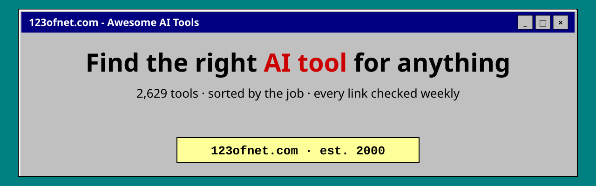

<div align="center">

<a href="https://123ofnet.com"></a>

# Awesome AI Tools

**2,629 AI tools for normal people and small businesses, sorted by what you want to get done.<br>Every website re-checked every week. Dead tools get removed, not left to rot.**

[](data/tools.json)
[](CHANGELOG.md)
[](CHANGELOG.md)
[](LICENSE)
[](https://github.com/vinpatel/awesome-ai-tools/stargazers)

**[🔎 Search all 2,629 on 123ofnet.com](https://123ofnet.com/directory/)** · **[📦 Get the data (JSON/CSV)](#-use-the-data)** · **[🪦 AI Tool Graveyard](#-the-ai-tool-graveyard)** · **[➕ Suggest a tool](https://123ofnet.com/submit/)**

<sub>⭐ <b>Star this repo</b> to keep it handy. New tools are added and dead ones removed every Monday.</sub>

</div>

---

## Why this list is different

Most "awesome AI" lists are huge, unsorted and full of dead links. This one is built to stay useful:

- ✅ **Checked every week.** A checker loads every tool's website weekly, and a person reviews anything it flags. Shut-down tools go to the [graveyard](#-the-ai-tool-graveyard).
- 🎯 **Sorted by the job, not the tech.** "Write my resume", "remove a background", "take meeting notes". Start from what you need.
- 🙋 **Quick picks chosen by a person** at the top of every category, for when you just want a good answer.
- 📦 **Free, open data.** The whole list is in [JSON](data/tools.json) and [CSV](data/tools.csv), CC BY 4.0. Build on it.
- 🤝 **Independent.** We aren't connected to the tools listed, and paying never skips the check. No affiliate links.
- 📟 **Running since 2000.** [123ofnet.com](https://123ofnet.com) started as a student web portal in 2000 ("An easy solution to the Net !!!") and came back for AI.

## 🎯 I want to...

| | |
|---|---|
| **[Chat & Assistants](#chat--assistants)** | [AI search](https://123ofnet.com/directory/assistants/ai-search/) · [Browser & extensions](https://123ofnet.com/directory/assistants/browser-and-extensions/) · [Agents that do tasks](https://123ofnet.com/directory/assistants/agents-that-do-tasks/) · [Voice](https://123ofnet.com/directory/assistants/voice/) · [Run privately / open source](https://123ofnet.com/directory/assistants/run-privately-open-source/) · [Many models in one](https://123ofnet.com/directory/assistants/many-models-in-one/) |
| **[Writing & Email](#writing--email)** | [Grammar & spelling](https://123ofnet.com/directory/writing/grammar-and-spelling/) · [Translation](https://123ofnet.com/directory/writing/translation/) · [Email](https://123ofnet.com/directory/writing/email/) · [Blog & SEO](https://123ofnet.com/directory/writing/blog-and-seo/) · [Social & LinkedIn](https://123ofnet.com/directory/writing/social-and-linkedin/) · [Marketing copy](https://123ofnet.com/directory/writing/marketing-copy/) |
| **[Career & Jobs](#career--jobs)** | [Resume builders](https://123ofnet.com/directory/career/resume-builders/) · [Cover letters](https://123ofnet.com/directory/career/cover-letters/) · [Interview practice](https://123ofnet.com/directory/career/interview-practice/) · [Job search](https://123ofnet.com/directory/career/job-search/) · [Hiring & recruiting](https://123ofnet.com/directory/career/hiring-and-recruiting/) · [Assessments](https://123ofnet.com/directory/career/assessments/) |
| **[Pictures & Design](#pictures--design)** | [Image generators](https://123ofnet.com/directory/design/image-generators/) · [Photo editing](https://123ofnet.com/directory/design/photo-editing/) · [Logos](https://123ofnet.com/directory/design/logos/) · [Headshots](https://123ofnet.com/directory/design/headshots/) · [Remove background](https://123ofnet.com/directory/design/remove-background/) · [Interior & architecture](https://123ofnet.com/directory/design/interior-and-architecture/) · [Product photos](https://123ofnet.com/directory/design/product-photos/) |
| **[Video & Audio](#video--audio)** | [Video generators](https://123ofnet.com/directory/video/video-generators/) · [Video editors](https://123ofnet.com/directory/video/video-editors/) · [Captions & subtitles](https://123ofnet.com/directory/video/captions-and-subtitles/) · [Voices & text-to-speech](https://123ofnet.com/directory/video/voices-and-text-to-speech/) · [Music & songs](https://123ofnet.com/directory/video/music-and-songs/) · [Short clips for social](https://123ofnet.com/directory/video/short-clips-for-social/) · [Podcasts](https://123ofnet.com/directory/video/podcasts/) |
| **[Meetings & Work](#meetings--work)** | [Meeting notes](https://123ofnet.com/directory/work/meeting-notes/) · [Slides & presentations](https://123ofnet.com/directory/work/slides-and-presentations/) · [Calendar & scheduling](https://123ofnet.com/directory/work/calendar-and-scheduling/) · [Email & inbox](https://123ofnet.com/directory/work/email-and-inbox/) · [Automation](https://123ofnet.com/directory/work/automation/) · [Spreadsheets & data](https://123ofnet.com/directory/work/spreadsheets-and-data/) · [Notes & docs](https://123ofnet.com/directory/work/notes-and-docs/) |
| **[Websites & Business](#websites--business)** | [Website builders](https://123ofnet.com/directory/business/website-builders/) · [Customer support](https://123ofnet.com/directory/business/customer-support/) · [Phone & receptionist](https://123ofnet.com/directory/business/phone-and-receptionist/) · [Marketing](https://123ofnet.com/directory/business/marketing/) · [Social media](https://123ofnet.com/directory/business/social-media/) · [Online stores](https://123ofnet.com/directory/business/online-stores/) · [Sales](https://123ofnet.com/directory/business/sales/) · [Reviews](https://123ofnet.com/directory/business/reviews/) |
| **[Build Apps (No Code)](#build-apps-no-code)** | [No-code app builders](https://123ofnet.com/directory/build/no-code-app-builders/) · [Mobile apps](https://123ofnet.com/directory/build/mobile-apps/) · [AI agents & chatbots](https://123ofnet.com/directory/build/ai-agents-and-chatbots/) · [Internal tools](https://123ofnet.com/directory/build/internal-tools/) · [Games](https://123ofnet.com/directory/build/games/) · [Databases & backends](https://123ofnet.com/directory/build/databases-and-backends/) |
| **[Developer](#developer)** | [Coding agents](https://123ofnet.com/directory/developer/coding-agents/) · [Code review](https://123ofnet.com/directory/developer/code-review/) · [Testing](https://123ofnet.com/directory/developer/testing/) · [Open source](https://123ofnet.com/directory/developer/open-source/) · [Observability & evals](https://123ofnet.com/directory/developer/observability-and-evals/) · [Vector databases](https://123ofnet.com/directory/developer/vector-databases/) · [Security](https://123ofnet.com/directory/developer/security/) · [Model hosting](https://123ofnet.com/directory/developer/model-hosting/) |
| **[Learning & Research](#learning--research)** | [Tutors](https://123ofnet.com/directory/learn/tutors/) · [Languages](https://123ofnet.com/directory/learn/languages/) · [Flashcards & quizzes](https://123ofnet.com/directory/learn/flashcards-and-quizzes/) · [Research papers](https://123ofnet.com/directory/learn/research-papers/) · [For teachers](https://123ofnet.com/directory/learn/for-teachers/) · [Maths](https://123ofnet.com/directory/learn/maths/) · [Courses](https://123ofnet.com/directory/learn/courses/) |

<sub>Each link opens a short buyer's guide plus every matching tool on 123ofnet.com.</sub>

## Contents

- [Chat & Assistants](#chat--assistants) (200)
- [Writing & Email](#writing--email) (220)
- [Career & Jobs](#career--jobs) (268)
- [Pictures & Design](#pictures--design) (261)
- [Video & Audio](#video--audio) (262)
- [Meetings & Work](#meetings--work) (286)
- [Websites & Business](#websites--business) (294)
- [Build Apps (No Code)](#build-apps-no-code) (213)
- [Developer](#developer) (364)
- [Learning & Research](#learning--research) (261)
- [📦 Use the data](#-use-the-data)
- [🪦 The AI Tool Graveyard](#-the-ai-tool-graveyard)
- [For tool makers](#for-tool-makers)

## Chat & Assistants

An AI assistant is the place most people start: you type a question or task in plain English and it answers, writes, explains or plans. They all do the basics well, so the right one depends on what you use every day and what you need most.

**Quick picks**

- **Writing, editing and long documents:** [Claude](https://claude.ai) - AI assistant that's strong at writing, analysis and long documents. [Details & alternatives](https://123ofnet.com/tool/claude/)
- **All-round everyday help:** [ChatGPT](https://chatgpt.com) - General AI assistant for writing, questions and ideas. [Details & alternatives](https://123ofnet.com/tool/chatgpt/)
- **You live in Gmail, Docs and Android:** [Gemini](https://gemini.google.com) - Google's AI assistant, works with Gmail and Docs. [Details & alternatives](https://123ofnet.com/tool/gemini/)
- **You use Windows, Word and Outlook:** [Microsoft Copilot](https://copilot.microsoft.com) - Microsoft's AI assistant, built into Windows and Office. [Details & alternatives](https://123ofnet.com/tool/microsoft-copilot/)
- **Answers with sources you can check:** [Perplexity](https://www.perplexity.ai) - AI search engine that shows its sources. [Details & alternatives](https://123ofnet.com/tool/perplexity/)
- **Trying many AI models in one place:** [Poe](https://poe.com) - Use many different AI models in one app. [Details & alternatives](https://123ofnet.com/tool/poe/)

**More chat & assistants tools**

- [HuggingChat](https://huggingface.co/chat/) - Free chat with open-source AI models. [Details & alternatives](https://123ofnet.com/tool/huggingchat/)
- [LibreChat](https://www.librechat.ai) - Free open-source chat app supporting many AI models. [Details & alternatives](https://123ofnet.com/tool/librechat/)
- [Flowith](https://flowith.io) - Canvas-based AI agent for research and long multi-step tasks. [Details & alternatives](https://123ofnet.com/tool/flowith/)
- [ChatWise](https://chatwise.app) - Fast, private desktop chat app for multiple AI models. [Details & alternatives](https://123ofnet.com/tool/chatwise/)
- [Ninja AI](https://www.myninja.ai) - AI agent for research, writing and tasks with many models. [Details & alternatives](https://123ofnet.com/tool/ninja-ai/)
- [Metaso](https://metaso.cn) - AI search engine with cited, structured answers (Chinese). [Details & alternatives](https://123ofnet.com/tool/metaso/)
- [MiniMax Agent](https://agent.minimax.io) - General AI agent that researches, builds files and completes tasks. [Details & alternatives](https://123ofnet.com/tool/minimax-agent/)
- [Scira](https://scira.ai) - Open-source AI search engine with cited answers. [Details & alternatives](https://123ofnet.com/tool/scira/)
- [Tabbit](https://www.tabbit.ai) - AI browser with an assistant and agents for web tasks. [Details & alternatives](https://123ofnet.com/tool/tabbit/)
- [Doubao](https://www.doubao.com) - ByteDance's AI assistant for chat, writing and search (Chinese). [Details & alternatives](https://123ofnet.com/tool/doubao/)
- [ERNIE Bot](https://yiyan.baidu.com) - Baidu's AI chatbot for questions, writing and search (Chinese). [Details & alternatives](https://123ofnet.com/tool/ernie-bot/)
- [Felo](https://felo.ai) - AI search engine that answers questions with cited sources. [Details & alternatives](https://123ofnet.com/tool/felo/)
- [Andi](https://andisearch.com) - Conversational AI search engine with clean, ad-free answers. [Details & alternatives](https://123ofnet.com/tool/andi/)
- [BrowserOS](https://www.browseros.com) - Open-source agentic browser that runs AI agents locally. [Details & alternatives](https://123ofnet.com/tool/browseros/)
- [Duck.ai](https://duck.ai) - DuckDuckGo's private, anonymous chat with popular AI models. [Details & alternatives](https://123ofnet.com/tool/duck-ai/)

[All 200 Chat & Assistants tools](categories/assistants.md) · [How to choose chat & assistants tools on 123ofnet.com](https://123ofnet.com/directory/assistants/)

## Writing & Email

AI writing tools range from simple grammar checkers to full writers that draft emails, posts and articles. Most people need one checker that fixes their own writing, and maybe one assistant for first drafts.

**Quick picks**

- **Fixing grammar and tone as you type:** [Grammarly](https://www.grammarly.com) - Fixes grammar and tone as you type. [Details & alternatives](https://123ofnet.com/tool/grammarly/)
- **Rewriting a sentence that sounds wrong:** [Wordtune](https://www.wordtune.com) - Rewrites your sentences to sound clearer. [Details & alternatives](https://123ofnet.com/tool/wordtune/)
- **Writing in more than one language:** [LanguageTool](https://languagetool.org) - Grammar and spelling checker for 30+ languages. [Details & alternatives](https://123ofnet.com/tool/languagetool/)
- **Making writing short and clear:** [Hemingway Editor](https://hemingwayapp.com) - Makes your writing bold and clear. [Details & alternatives](https://123ofnet.com/tool/hemingway-editor/)
- **Marketing copy and sales emails:** [Copy.ai](https://www.copy.ai) - AI writing and workflows for sales and marketing. [Details & alternatives](https://123ofnet.com/tool/copy-ai/)
- **Fiction and creative writing:** [Sudowrite](https://sudowrite.com) - AI writing partner for fiction writers. [Details & alternatives](https://123ofnet.com/tool/sudowrite/)

**More writing & email tools**

- [Ginger](https://www.gingersoftware.com) - Grammar and spelling checker with rephrasing and translation. [Details & alternatives](https://123ofnet.com/tool/ginger/)
- [Lingvanex](https://lingvanex.com) - Machine translation for text, documents and websites. [Details & alternatives](https://123ofnet.com/tool/lingvanex/)
- [ContentBot](https://contentbot.ai) - AI writer for blog posts and marketing content. [Details & alternatives](https://123ofnet.com/tool/contentbot/)
- [Koala AI](https://koala.sh) - AI writer for SEO-optimized blog posts and affiliate articles. [Details & alternatives](https://123ofnet.com/tool/koala-ai/)
- [Junia AI](https://www.junia.ai) - AI writer for long-form SEO blog content. [Details & alternatives](https://123ofnet.com/tool/junia-ai/)
- [ProWritingAid](https://prowritingaid.com) - Grammar checker and style editor for long writing. [Details & alternatives](https://123ofnet.com/tool/prowritingaid/)
- [Scalenut](https://www.scalenut.com) - AI SEO platform for planning and writing blog content. [Details & alternatives](https://123ofnet.com/tool/scalenut/)
- [Writecream](https://www.writecream.com) - AI helpers that handle blogging, email outreach and review replies. [Details & alternatives](https://123ofnet.com/tool/writecream/)
- [Writesonic](https://writesonic.com) - Tracks and improves how your brand shows up in AI chatbot answers. [Details & alternatives](https://123ofnet.com/tool/writesonic/)
- [Reverso](https://www.reverso.net) - Translation, rephrasing and grammar checking across many languages. [Details & alternatives](https://123ofnet.com/tool/reverso/)
- [Yandex Translate](https://translate.yandex.com) - Free online translator for text, documents and images. [Details & alternatives](https://123ofnet.com/tool/yandex-translate/)
- [Google Translate](https://translate.google.com) - Free translation for text, documents and websites. [Details & alternatives](https://123ofnet.com/tool/google-translate/)
- [Scribens](https://www.scribens.com) - Free grammar and spelling checker for English and French. [Details & alternatives](https://123ofnet.com/tool/scribens/)
- [Smartcat](https://www.smartcat.com) - AI translation platform for business content. [Details & alternatives](https://123ofnet.com/tool/smartcat/)
- [Article Forge](https://www.articleforge.com) - Generates long-form SEO articles automatically. [Details & alternatives](https://123ofnet.com/tool/article-forge/)

[All 220 Writing & Email tools](categories/writing.md) · [How to choose writing & email tools on 123ofnet.com](https://123ofnet.com/directory/writing/)

## Career & Jobs

AI career tools help with the three hardest parts of job hunting: a resume that gets past screening software, a cover letter that matches the job, and practice before the interview.

**Quick picks**

- **Matching your resume to a job ad:** [Jobscan](https://www.jobscan.co) - Compares your resume to a job ad and shows what's missing. [Details & alternatives](https://123ofnet.com/tool/jobscan/)
- **Building a resume from scratch:** [Kickresume](https://www.kickresume.com) - AI resume and cover letter writer. [Details & alternatives](https://123ofnet.com/tool/kickresume/)
- **Tracking many job applications:** [Teal](https://www.tealhq.com) - Resume builder and job tracker. [Details & alternatives](https://123ofnet.com/tool/teal/)
- **Scoring your resume and LinkedIn:** [Resume Worded](https://resumeworded.com) - Scores your resume and LinkedIn profile. [Details & alternatives](https://123ofnet.com/tool/resume-worded/)
- **Speaking and presentation coaching:** [Yoodli](https://yoodli.ai) - AI speech coach for interviews and presentations. [Details & alternatives](https://123ofnet.com/tool/yoodli/)

**More career & jobs tools**

- [Resume.io](https://resume.io) - Resume and cover letter builder with templates and AI writing suggestions. [Details & alternatives](https://123ofnet.com/tool/resume-io/)
- [CodeSignal](https://codesignal.com) - Technical assessments and AI interviewer for hiring. [Details & alternatives](https://123ofnet.com/tool/codesignal/)
- [Jobright](https://jobright.ai) - AI job search copilot that matches jobs and tailors resumes. [Details & alternatives](https://123ofnet.com/tool/jobright/)
- [Resumaker.ai](https://resumaker.ai) - AI resume and cover letter builder with ATS-friendly templates. [Details & alternatives](https://123ofnet.com/tool/resumaker-ai/)
- [Glider AI](https://glider.ai) - AI skills assessments and interviews for hiring. [Details & alternatives](https://123ofnet.com/tool/glider-ai/)
- [Wonsulting AI](https://www.wonsulting.com/wonsultingai) - Suite of AI job search tools: resume, cover letter, networking messages. [Details & alternatives](https://123ofnet.com/tool/wonsulting-ai/)
- [Aced (formerly Exponent)](https://www.aced.io) - Interview prep courses, mock interviews and AI practice for tech and PM roles. [Details & alternatives](https://123ofnet.com/tool/aced/)
- [Interviewer.AI](https://interviewer.ai) - AI video interviewing and candidate screening for recruiters. [Details & alternatives](https://123ofnet.com/tool/interviewer-ai/)
- [Testlify](https://testlify.com) - AI skills assessments and conversational interviews for hiring. [Details & alternatives](https://123ofnet.com/tool/testlify/)
- [HireVue](https://www.hirevue.com) - Video interviewing and AI-driven hiring assessments. [Details & alternatives](https://123ofnet.com/tool/hirevue/)
- [Indeed](https://www.indeed.com) - Job search site with AI job matching and resume tools. [Details & alternatives](https://123ofnet.com/tool/indeed/)
- [LinkedIn Jobs](https://www.linkedin.com/jobs/) - Job search with AI-assisted matching on LinkedIn. [Details & alternatives](https://123ofnet.com/tool/linkedin-jobs/)
- [Xobin](https://xobin.com) - AI skills assessments and video interviews for hiring. [Details & alternatives](https://123ofnet.com/tool/xobin/)
- [Zety](https://zety.com) - Resume builder with AI-suggested bullet points and cover letter writer. [Details & alternatives](https://123ofnet.com/tool/zety/)
- [MyPerfectResume](https://www.myperfectresume.com) - Guided resume and cover letter builder with suggested wording. [Details & alternatives](https://123ofnet.com/tool/myperfectresume/)

[All 268 Career & Jobs tools](categories/career.md) · [How to choose career & jobs tools on 123ofnet.com](https://123ofnet.com/directory/career/)

## Pictures & Design

AI design tools can make images from a sentence, clean up photos, and produce logos and social posts in minutes. The right tool depends on whether you need art, business graphics or photo fixes.

**Quick picks**

- **Social posts, flyers and slides:** [Canva](https://www.canva.com) - Easy design for posts, flyers and slides, with AI tools. [Details & alternatives](https://123ofnet.com/tool/canva/)
- **Artistic, high-quality images:** [Midjourney](https://www.midjourney.com) - Makes artistic images from text. [Details & alternatives](https://123ofnet.com/tool/midjourney/)
- **Images with readable text in them:** [Ideogram](https://ideogram.ai) - Image generator that's good at text inside images. [Details & alternatives](https://123ofnet.com/tool/ideogram/)
- **Images that are safer for business use:** [Adobe Firefly](https://www.adobe.com/products/firefly.html) - Adobe's image generator, safe for business use. [Details & alternatives](https://123ofnet.com/tool/adobe-firefly/)
- **A logo and brand kit:** [Looka](https://looka.com) - AI logo maker and brand kit. [Details & alternatives](https://123ofnet.com/tool/looka/)
- **Product photos and backgrounds:** [Photoroom](https://www.photoroom.com) - Product photos and background removal. [Details & alternatives](https://123ofnet.com/tool/photoroom/)

**More pictures & design tools**

- [Deep Dream Generator](https://deepdreamgenerator.com) - Create AI art and apply artistic styles to photos. [Details & alternatives](https://123ofnet.com/tool/deep-dream-generator/)
- [Pixlr](https://pixlr.com) - Online photo editor with AI generation and editing tools. [Details & alternatives](https://123ofnet.com/tool/pixlr/)
- [Mokker](https://mokker.ai) - Create product photos with AI-generated backgrounds. [Details & alternatives](https://123ofnet.com/tool/mokker/)
- [Pixelcut](https://www.pixelcut.ai) - Make product photos, remove backgrounds and edit images. [Details & alternatives](https://123ofnet.com/tool/pixelcut/)
- [Pebblely](https://pebblely.com) - Turn product photos into styled scenes with AI. [Details & alternatives](https://123ofnet.com/tool/pebblely/)
- [remove.bg](https://www.remove.bg) - Removes a photo's background in one click. [Details & alternatives](https://123ofnet.com/tool/remove-bg/)
- [Meshy](https://www.meshy.ai) - Generate 3D models from text or images. [Details & alternatives](https://123ofnet.com/tool/meshy/)
- [Photoleap](https://www.photoleapapp.com) - Mobile photo editor with AI art and editing tools. [Details & alternatives](https://123ofnet.com/tool/photoleap/)
- [Freepik AI Image Generator](https://www.freepik.com/ai/image-generator) - Generate images from text inside Freepik's design suite. [Details & alternatives](https://123ofnet.com/tool/freepik-ai-image-generator/)
- [Craiyon](https://www.craiyon.com) - Free AI image generator from text prompts. [Details & alternatives](https://123ofnet.com/tool/craiyon/)
- [Picwish](https://picwish.com) - Remove backgrounds, enhance and edit photos with AI. [Details & alternatives](https://123ofnet.com/tool/picwish/)
- [3D AI Studio](https://www.3daistudio.com) - Generate 3D models from text or images. [Details & alternatives](https://123ofnet.com/tool/3d-ai-studio/)
- [Interior AI](https://interiorai.com) - Redesign room photos in different interior styles. [Details & alternatives](https://123ofnet.com/tool/interior-ai/)
- [NightCafe](https://creator.nightcafe.studio) - AI art generator with many models and a creator community. [Details & alternatives](https://123ofnet.com/tool/nightcafe/)
- [Portrait Pal](https://portraitpal.ai) - AI headshot generator for professional photos. [Details & alternatives](https://123ofnet.com/tool/portrait-pal/)

[All 261 Pictures & Design tools](categories/design.md) · [How to choose pictures & design tools on 123ofnet.com](https://123ofnet.com/directory/design/)

## Video & Audio

AI video and audio tools can edit video by editing text, add captions automatically, generate clips from a description, and create natural voices and music. Most people only need one editor plus one specialist tool.

**Quick picks**

- **Editing talking videos and podcasts:** [Descript](https://www.descript.com) - Edit video by editing the transcript. [Details & alternatives](https://123ofnet.com/tool/descript/)
- **Free editing with auto captions:** [CapCut](https://www.capcut.com) - Free video editor with auto captions and AI effects. [Details & alternatives](https://123ofnet.com/tool/capcut/)
- **Turning long videos into short clips:** [OpusClip](https://www.opus.pro) - Turns long videos into short clips for social media. [Details & alternatives](https://123ofnet.com/tool/opusclip/)
- **Videos with an AI presenter:** [HeyGen](https://www.heygen.com) - AI presenter videos and translation. [Details & alternatives](https://123ofnet.com/tool/heygen/)
- **Natural AI voiceovers:** [ElevenLabs](https://elevenlabs.io) - Natural-sounding AI voices. [Details & alternatives](https://123ofnet.com/tool/elevenlabs/)
- **Making songs from a description:** [Suno](https://suno.com) - Make songs from a text description. [Details & alternatives](https://123ofnet.com/tool/suno/)

**More video & audio tools**

- [Clipchamp](https://clipchamp.com) - Microsoft browser video editor with auto captions and AI voices. [Details & alternatives](https://123ofnet.com/tool/clipchamp/)
- [Vizard](https://vizard.ai) - Cuts long videos into short social clips with captions. [Details & alternatives](https://123ofnet.com/tool/vizard/)
- [Fliki](https://fliki.ai) - Turns text into videos with AI voices and stock media. [Details & alternatives](https://123ofnet.com/tool/fliki/)
- [Ecrett Music](https://ecrettmusic.com) - Royalty-free music generator for video creators. [Details & alternatives](https://123ofnet.com/tool/ecrett-music/)
- [Hailuo AI](https://hailuoai.video) - Generates short video clips from text or image prompts. [Details & alternatives](https://123ofnet.com/tool/hailuo-ai/)
- [Voicemaker](https://voicemaker.in) - Converts text to speech with many voices. [Details & alternatives](https://123ofnet.com/tool/voicemaker/)
- [Kapwing](https://www.kapwing.com) - Online video editor with AI subtitles, resizing and cleanup. [Details & alternatives](https://123ofnet.com/tool/kapwing/)
- [Mubert](https://mubert.com) - Generates royalty-free music streams and tracks. [Details & alternatives](https://123ofnet.com/tool/mubert/)
- [Soundraw](https://soundraw.io) - Generates royalty-free music you can customize. [Details & alternatives](https://123ofnet.com/tool/soundraw/)
- [Wondercraft](https://www.wondercraft.ai) - Turns text into podcasts and audio ads with AI voices. [Details & alternatives](https://123ofnet.com/tool/wondercraft/)
- [Typecast](https://typecast.ai) - Text to speech with expressive character voices. [Details & alternatives](https://123ofnet.com/tool/typecast/)
- [VEED](https://www.veed.io) - Online video editor with AI subtitles. [Details & alternatives](https://123ofnet.com/tool/veed/)
- [Beatoven.ai](https://www.beatoven.ai) - Creates royalty-free background music for videos. [Details & alternatives](https://123ofnet.com/tool/beatoven-ai/)
- [Artlist](https://artlist.io) - Royalty-free music, footage and AI video tools for creators. [Details & alternatives](https://123ofnet.com/tool/artlist/)
- [Loudly](https://www.loudly.com) - AI music generator and royalty-free music library. [Details & alternatives](https://123ofnet.com/tool/loudly/)

[All 262 Video & Audio tools](categories/video.md) · [How to choose video & audio tools on 123ofnet.com](https://123ofnet.com/directory/video/)

## Meetings & Work

AI work tools take care of the busywork: meeting notes, scheduling, slides and repetitive tasks between apps. One good notetaker and one automation tool can save hours every week.

**Quick picks**

- **Automatic meeting notes:** [Otter.ai](https://otter.ai) - Meeting transcripts and summaries. [Details & alternatives](https://123ofnet.com/tool/otter-ai/)
- **A free meeting notetaker:** [Fathom](https://www.fathom.ai) - Free AI meeting notetaker. [Details & alternatives](https://123ofnet.com/tool/fathom/)
- **Improving your own meeting notes:** [Granola](https://www.granola.ai) - AI notepad that improves your own meeting notes. [Details & alternatives](https://123ofnet.com/tool/granola/)
- **Slides from a short prompt:** [Gamma](https://gamma.app) - Make slide decks from a prompt. [Details & alternatives](https://123ofnet.com/tool/gamma/)
- **Planning your day automatically:** [Motion](https://www.usemotion.com) - AI planner that schedules your tasks for you. [Details & alternatives](https://123ofnet.com/tool/motion/)
- **Connecting apps without code:** [Zapier](https://zapier.com) - Connect apps and automate tasks, with AI steps. [Details & alternatives](https://123ofnet.com/tool/zapier/)

**More meetings & work tools**

- [Bluedot](https://www.bluedothq.com) - Records meetings without a bot and writes notes and emails. [Details & alternatives](https://123ofnet.com/tool/bluedot/)
- [Circleback](https://circleback.ai) - Writes meeting notes and action items, and automates follow-ups. [Details & alternatives](https://123ofnet.com/tool/circleback/)
- [Notta](https://www.notta.ai) - Transcribes meetings and audio files and creates summaries. [Details & alternatives](https://123ofnet.com/tool/notta/)
- [Jamie](https://www.meetjamie.ai) - Bot-free meeting notes for in-person and online meetings. [Details & alternatives](https://123ofnet.com/tool/jamie/)
- [tl;dv](https://tldv.io) - Records Zoom, Meet and Teams calls and writes notes. [Details & alternatives](https://123ofnet.com/tool/tl-dv/)
- [Dust](https://dust.tt) - Build custom AI agents connected to company data. [Details & alternatives](https://123ofnet.com/tool/dust/)
- [Presentations.AI](https://www.presentations.ai) - Generates presentation decks from a prompt. [Details & alternatives](https://123ofnet.com/tool/presentations-ai/)
- [Parseur](https://parseur.com) - Extracts data from emails and PDFs into spreadsheets. [Details & alternatives](https://123ofnet.com/tool/parseur/)
- [Make](https://www.make.com) - Visual automation builder. [Details & alternatives](https://123ofnet.com/tool/make/)
- [Docsumo](https://www.docsumo.com) - Extracts data from business documents. [Details & alternatives](https://123ofnet.com/tool/docsumo/)
- [Lindy](https://www.lindy.ai) - Build AI agents that handle email, scheduling and work tasks. [Details & alternatives](https://123ofnet.com/tool/lindy/)
- [Gumloop](https://www.gumloop.com) - No-code AI automation workflows and agents. [Details & alternatives](https://123ofnet.com/tool/gumloop/)
- [Bardeen](https://www.bardeen.ai) - Browser automation for sales and repetitive web tasks. [Details & alternatives](https://123ofnet.com/tool/bardeen/)
- [MeetGeek](https://meetgeek.ai) - Automatically records, transcribes and summarizes video meetings. [Details & alternatives](https://123ofnet.com/tool/meetgeek/)
- [Spinach](https://www.spinach.ai) - AI meeting assistant that writes notes and updates project tools. [Details & alternatives](https://123ofnet.com/tool/spinach/)

[All 286 Meetings & Work tools](categories/work.md) · [How to choose meetings & work tools on 123ofnet.com](https://123ofnet.com/directory/work/)

## Websites & Business

AI tools for small businesses help you get a website live, answer customers around the clock, and run marketing without a big team. Start with the one that brings in customers or saves the most time.

**Quick picks**

- **A small-business website, fast:** [Durable](https://durable.com) - AI website builder for small businesses. [Details & alternatives](https://123ofnet.com/tool/durable/)
- **A flexible site with lots of templates:** [Wix](https://www.wix.com) - Website builder with an AI site creator. [Details & alternatives](https://123ofnet.com/tool/wix/)
- **A polished site or online store:** [Squarespace](https://www.squarespace.com) - Good-looking websites and online stores. [Details & alternatives](https://123ofnet.com/tool/squarespace/)
- **Selling products online:** [Shopify Magic](https://www.shopify.com/magic) - AI tools built into Shopify stores. [Details & alternatives](https://123ofnet.com/tool/shopify-magic/)
- **A support chatbot trained on your site:** [Chatbase](https://www.chatbase.co) - Build an AI support chatbot from your website. [Details & alternatives](https://123ofnet.com/tool/chatbase/)
- **Ideas for a business name:** [Namelix](https://namelix.com) - AI business name generator. [Details & alternatives](https://123ofnet.com/tool/namelix/)

**More websites & business tools**

- [HubSpot AI](https://www.hubspot.com/products/artificial-intelligence) - HubSpot Agent Hub: AI agents for marketing, sales and customer service. [Details & alternatives](https://123ofnet.com/tool/hubspot-ai/)
- [Hootsuite](https://www.hootsuite.com) - Social media management with OwlyWriter AI for posts. [Details & alternatives](https://123ofnet.com/tool/hootsuite/)
- [Strikingly](https://www.strikingly.com) - Simple one-page website builder with an AI site generator. [Details & alternatives](https://123ofnet.com/tool/strikingly/)
- [Gorgias](https://www.gorgias.com) - Customer support helpdesk with AI agent built for online stores. [Details & alternatives](https://123ofnet.com/tool/gorgias/)
- [Fin by Intercom](https://fin.ai) - AI customer support agent. [Details & alternatives](https://123ofnet.com/tool/fin-by-intercom/)
- [Jimdo](https://www.jimdo.com) - Website and online store builder that creates a site from a few questions. [Details & alternatives](https://123ofnet.com/tool/jimdo/)
- [Unicorn Platform](https://unicornplatform.com) - Landing page and website builder with an AI site generator for startups. [Details & alternatives](https://123ofnet.com/tool/unicorn-platform/)
- [Klaviyo](https://www.klaviyo.com) - Email and SMS marketing for online stores with AI features. [Details & alternatives](https://123ofnet.com/tool/klaviyo/)
- [Later](https://later.com) - Social media scheduler with AI captions for Instagram and TikTok. [Details & alternatives](https://123ofnet.com/tool/later/)
- [Sprout Social](https://sproutsocial.com) - Social media management, listening and analytics with AI. [Details & alternatives](https://123ofnet.com/tool/sprout-social/)
- [AWeber](https://www.aweber.com) - Email marketing with AI writing assistant for small businesses. [Details & alternatives](https://123ofnet.com/tool/aweber/)
- [Goodcall](https://www.goodcall.com) - AI phone agent that answers business calls around the clock. [Details & alternatives](https://123ofnet.com/tool/goodcall/)
- [Keap](https://keap.com) - CRM, sales and marketing automation for small businesses. [Details & alternatives](https://123ofnet.com/tool/keap/)
- [Vista Social](https://vistasocial.com) - Social media management with AI content and review tools. [Details & alternatives](https://123ofnet.com/tool/vista-social/)
- [Yotpo](https://www.yotpo.com) - Product reviews and loyalty programs for online stores. [Details & alternatives](https://123ofnet.com/tool/yotpo/)

[All 294 Websites & Business tools](categories/business.md) · [How to choose websites & business tools on 123ofnet.com](https://123ofnet.com/directory/business/)

## Build Apps (No Code)

No-code AI builders let you describe an app in plain English and get a working version, without being a programmer. They're great for prototypes, internal tools and simple products.

**Quick picks**

- **A web app from a chat description:** [Lovable](https://lovable.dev) - Build web apps by chatting. [Details & alternatives](https://123ofnet.com/tool/lovable/)
- **Prompting and deploying in the browser:** [Bolt](https://bolt.new) - Prompt, run and deploy web apps in the browser. [Details & alternatives](https://123ofnet.com/tool/bolt/)
- **Building and hosting with an AI agent:** [Replit](https://replit.com) - Build and host apps with an AI agent. [Details & alternatives](https://123ofnet.com/tool/replit/)
- **Turning a spreadsheet into an app:** [Glide](https://www.glideapps.com) - Turn spreadsheets into apps. [Details & alternatives](https://123ofnet.com/tool/glide/)
- **A complex web app without code:** [Bubble](https://bubble.io) - No-code platform for full web apps. [Details & alternatives](https://123ofnet.com/tool/bubble/)
- **A mobile app:** [FlutterFlow](https://flutterflow.io) - Visual builder for mobile and web apps. [Details & alternatives](https://123ofnet.com/tool/flutterflow/)

**More build apps (no code) tools**

- [Tadabase](https://tadabase.io) - No-code platform for building database web apps. [Details & alternatives](https://123ofnet.com/tool/tadabase/)
- [Knack](https://www.knack.com) - No-code database and app builder for business workflows. [Details & alternatives](https://123ofnet.com/tool/knack/)
- [Emergent](https://emergent.sh) - AI agents that build full-stack web and mobile apps from chat. [Details & alternatives](https://123ofnet.com/tool/emergent/)
- [Appy Pie](https://www.appypie.com) - No-code builder for mobile apps, websites and chatbots. [Details & alternatives](https://123ofnet.com/tool/appy-pie/)
- [AppMaster](https://appmaster.io) - No-code platform that generates backend, web and mobile apps. [Details & alternatives](https://123ofnet.com/tool/appmaster/)
- [Creatio](https://www.creatio.com) - No-code platform for CRM and workflow apps with AI agents. [Details & alternatives](https://123ofnet.com/tool/creatio/)
- [Rosebud AI](https://rosebud.ai) - Make browser games by describing them in chat. [Details & alternatives](https://123ofnet.com/tool/rosebud-ai/)
- [Baserow](https://baserow.io) - Open-source no-code database with AI and app builder. [Details & alternatives](https://123ofnet.com/tool/baserow/)
- [Budibase](https://budibase.com) - Open-source low-code platform for internal tools and forms. [Details & alternatives](https://123ofnet.com/tool/budibase/)
- [Jabali](https://www.jabali.ai) - AI game maker that creates games from prompts. [Details & alternatives](https://123ofnet.com/tool/jabali/)
- [Rork](https://rork.com) - Builds native mobile apps from a text description. [Details & alternatives](https://123ofnet.com/tool/rork/)
- [ToolJet](https://www.tooljet.com) - AI-assisted low-code builder for internal business tools. [Details & alternatives](https://123ofnet.com/tool/tooljet/)
- [OnSpace](https://www.onspace.ai) - AI builder for mobile and web apps from prompts. [Details & alternatives](https://123ofnet.com/tool/onspace/)
- [Softr](https://www.softr.io) - Build portals and internal tools without code. [Details & alternatives](https://123ofnet.com/tool/softr/)
- [Summer Engine](https://www.summerengine.com) - AI game engine that builds games from plain language. [Details & alternatives](https://123ofnet.com/tool/summer-engine/)

[All 213 Build Apps (No Code) tools](categories/build.md) · [How to choose build apps (no code) tools on 123ofnet.com](https://123ofnet.com/directory/build/)

## Developer

AI coding tools range from autocomplete in your editor to agents that plan changes, edit many files and run tests. Most developers use one in-editor assistant plus one agent for bigger tasks.

**Quick picks**

- **An AI-first code editor:** [Cursor](https://cursor.com) - AI code editor. [Details & alternatives](https://123ofnet.com/tool/cursor/)
- **Autocomplete inside your current editor:** [GitHub Copilot](https://github.com/features/copilot) - AI pair programmer in your editor. [Details & alternatives](https://123ofnet.com/tool/github-copilot/)
- **An agent in your terminal:** [Claude Code](https://claude.com/product/claude-code) - Anthropic's AI coding agent for the terminal and IDE. [Details & alternatives](https://123ofnet.com/tool/claude-code/)
- **Open source, bring your own model:** [Cline](https://cline.bot) - Open-source AI coding agent for VS Code. [Details & alternatives](https://123ofnet.com/tool/cline/)
- **AI reviews on pull requests:** [CodeRabbit](https://www.coderabbit.ai) - AI code reviews on pull requests. [Details & alternatives](https://123ofnet.com/tool/coderabbit/)
- **If you use IntelliJ or PyCharm:** [JetBrains AI](https://www.jetbrains.com/ai/) - AI assistant for IntelliJ, PyCharm and other JetBrains IDEs. [Details & alternatives](https://123ofnet.com/tool/jetbrains-ai/)

**More developer tools**

- [Kilo](https://kilo.ai) - Open-source AI coding agent for VS Code and JetBrains. [Details & alternatives](https://123ofnet.com/tool/kilo/)
- [Haystack](https://haystack.deepset.ai) - Open-source framework for LLM and RAG pipelines. [Details & alternatives](https://123ofnet.com/tool/haystack/)
- [Goose](https://github.com/block/goose) - Open-source extensible AI agent for local coding and automation. [Details & alternatives](https://123ofnet.com/tool/goose/)
- [OpenCode](https://opencode.ai) - Open-source AI coding agent that runs in the terminal. [Details & alternatives](https://123ofnet.com/tool/opencode/)
- [Together AI](https://www.together.ai) - Cloud platform for open-source model inference and training. [Details & alternatives](https://123ofnet.com/tool/together-ai/)
- [Qodo](https://www.qodo.ai) - AI code review and test generation platform for developer teams. [Details & alternatives](https://123ofnet.com/tool/qodo/)
- [Augment Code](https://www.augmentcode.com) - AI coding agents for code review, tickets and routine dev tasks. [Details & alternatives](https://123ofnet.com/tool/augment-code/)
- [Fireworks AI](https://fireworks.ai) - Fast inference platform for open-source models. [Details & alternatives](https://123ofnet.com/tool/fireworks-ai/)
- [Gemini CLI](https://github.com/google-gemini/gemini-cli) - Google's open-source AI agent for the terminal. [Details & alternatives](https://123ofnet.com/tool/gemini-cli/)
- [Helicone](https://www.helicone.ai) - Open-source LLM observability and gateway. [Details & alternatives](https://123ofnet.com/tool/helicone/)
- [LiteLLM](https://www.litellm.ai) - Open-source LLM gateway with a unified API. [Details & alternatives](https://123ofnet.com/tool/litellm/)
- [OpenHands](https://www.openhands.dev) - Open-source platform for AI software development agents. [Details & alternatives](https://123ofnet.com/tool/openhands/)
- [Corgea](https://corgea.com) - AI-native static application security testing and autofix. [Details & alternatives](https://123ofnet.com/tool/corgea/)
- [Amazon Q Developer](https://aws.amazon.com/q/developer/) - AWS AI assistant for coding, testing, and cloud operations. [Details & alternatives](https://123ofnet.com/tool/amazon-q-developer/)
- [Ellipsis](https://www.ellipsis.dev) - Managed cloud coding agents and AI code review for teams. [Details & alternatives](https://123ofnet.com/tool/ellipsis/)

[All 364 Developer tools](categories/developer.md) · [How to choose developer tools on 123ofnet.com](https://123ofnet.com/directory/developer/)

## Learning & Research

AI learning tools explain hard topics simply, help you study and practise, and find and summarise research. Used well, they're like a patient tutor that's always available.

**Quick picks**

- **Finding research papers:** [Elicit](https://www.elicit.com) - Finds and summarises research papers. [Details & alternatives](https://123ofnet.com/tool/elicit/)
- **What the science says on a question:** [Consensus](https://consensus.app) - Answers questions using scientific studies. [Details & alternatives](https://123ofnet.com/tool/consensus/)
- **Flashcards and studying:** [Quizlet](https://quizlet.com) - Flashcards and AI study help. [Details & alternatives](https://123ofnet.com/tool/quizlet/)
- **A tutor for school subjects:** [Khanmigo](https://www.khanmigo.ai) - Khan Academy's AI tutor. [Details & alternatives](https://123ofnet.com/tool/khanmigo/)
- **Speaking practice in a new language:** [Speak](https://www.speak.com) - Learn to speak a language with an AI tutor. [Details & alternatives](https://123ofnet.com/tool/speak/)

**More learning & research tools**

- [Talkpal](https://talkpal.ai) - AI language tutor for speaking and writing practice in many languages. [Details & alternatives](https://123ofnet.com/tool/talkpal/)
- [YouLearn](https://www.youlearn.ai) - Turns PDFs, videos and lectures into notes, flashcards, quizzes and an AI tutor chat. [Details & alternatives](https://123ofnet.com/tool/youlearn/)
- [Semantic Scholar](https://www.semanticscholar.org) - Free AI-powered search for research papers. [Details & alternatives](https://123ofnet.com/tool/semantic-scholar/)
- [MagicSchool](https://www.magicschool.ai) - Suite of AI tools for teachers: lesson plans, rubrics, IEP help and parent emails. [Details & alternatives](https://123ofnet.com/tool/magicschool/)
- [Langotalk](https://langotalk.org) - Learn languages through chat and voice conversations with an AI tutor. [Details & alternatives](https://123ofnet.com/tool/langotalk/)
- [Talkio AI](https://www.talkio.ai) - Voice-based AI language tutor for conversation practice. [Details & alternatives](https://123ofnet.com/tool/talkio-ai/)
- [Class Companion](https://www.classcompanion.com) - Gives students instant feedback on writing practice assigned by teachers. [Details & alternatives](https://123ofnet.com/tool/class-companion/)
- [Babbel](https://www.babbel.com) - Language learning app with lessons and AI speaking practice. [Details & alternatives](https://123ofnet.com/tool/babbel/)
- [Bohrium](https://www.bohrium.com) - Scientific research platform with AI paper search and reading. [Details & alternatives](https://123ofnet.com/tool/bohrium/)
- [Memrise](https://www.memrise.com) - Language learning app with AI conversation practice and native-speaker videos. [Details & alternatives](https://123ofnet.com/tool/memrise/)
- [Brisk Teaching](https://www.briskteaching.com) - Chrome extension that helps teachers create resources and give feedback in Google Docs. [Details & alternatives](https://123ofnet.com/tool/brisk-teaching/)
- [Scite](https://scite.ai) - Shows how research papers have been cited. [Details & alternatives](https://123ofnet.com/tool/scite/)
- [Seneca Learning](https://senecalearning.com) - Free revision platform with adaptive courses for school exams. [Details & alternatives](https://123ofnet.com/tool/seneca-learning/)
- [Carnegie Learning](https://www.carnegielearning.com) - Math curriculum with MATHia adaptive AI tutoring software. [Details & alternatives](https://123ofnet.com/tool/carnegie-learning/)
- [Heylama](https://www.heylama.com) - AI language tutor for speaking practice with feedback. [Details & alternatives](https://123ofnet.com/tool/heylama/)

[All 261 Learning & Research tools](categories/learn.md) · [How to choose learning & research tools on 123ofnet.com](https://123ofnet.com/directory/learn/)

## 📦 Use the data

The whole list is free to use under [CC BY 4.0](LICENSE): just credit and link [123ofnet.com](https://123ofnet.com).
It's rebuilt every Monday.

```bash
# Every tool as JSON
curl -sL https://raw.githubusercontent.com/vinpatel/awesome-ai-tools/main/data/tools.json | jq '.tools[] | select(.category == "Chat & Assistants") | .name'
```

```python
import pandas as pd
tools = pd.read_csv("https://raw.githubusercontent.com/vinpatel/awesome-ai-tools/main/data/tools.csv")
print(tools.groupby("category").size())
```

Fields: `name`, `url`, `category`, `description`, `page` (details and alternatives on 123ofnet.com), `lastChecked`.

## 🪦 The AI Tool Graveyard

AI tools come and go fast. These were in the list and have shut down or stopped working. RIP.

| Tool | Category | Removed | What happened |
|---|---|---|---|
| Soundful | Video & Audio | 2026-11-23 | Website says the product is no longer available to the public |
| Gemini Code Assist (individual edition) | Developer | 2026-11-23 | Google shut down the individual edition on June 18, 2026 |
| Vanna (hosted service) | Developer | 2026-11-23 | Hosted service shut down; the open-source library lives on |
| Interview Warmup | Career & Jobs | 2026-11-23 | Its link now redirects to a general interview-tips article |

<sub>Know a tool here that's still alive, or one in the list that's dead? [Open an issue](https://github.com/vinpatel/awesome-ai-tools/issues/new/choose).</sub>

## For tool makers

**Listed here?** Add the retro badge to your site or README:

[](https://123ofnet.com)

```html
<a href="https://123ofnet.com"></a>
```

**Not listed yet?** [Submit your tool](https://123ofnet.com/submit/). It's free, and every tool is checked before it goes live.
**Want your tool removed?** [Opt out](https://123ofnet.com/opt-out/). It's free and you don't need to give a reason.

## Contributing

Suggest a tool at [123ofnet.com/submit](https://123ofnet.com/submit/) or [open an issue](https://github.com/vinpatel/awesome-ai-tools/issues/new/choose). See [CONTRIBUTING.md](CONTRIBUTING.md).

<div align="center">

### ⭐ If this list saved you some searching, star it so others can find it too.

<a href="https://star-history.com/#vinpatel/awesome-ai-tools&Date"></a>

</div>

---

Maintained by [123ofnet.com](https://123ofnet.com), an independent directory of AI tools for normal people and small businesses, online since 2000.
Every tool's website is checked before it's listed and re-checked weekly ([how we check](https://123ofnet.com/how-we-check/)).
Tool descriptions are short summaries; prices and features change, so check each tool's website.
Listing a tool doesn't mean we're connected to it or endorse it. Own a listed tool and want it removed? [Opt out here](https://123ofnet.com/opt-out/).
